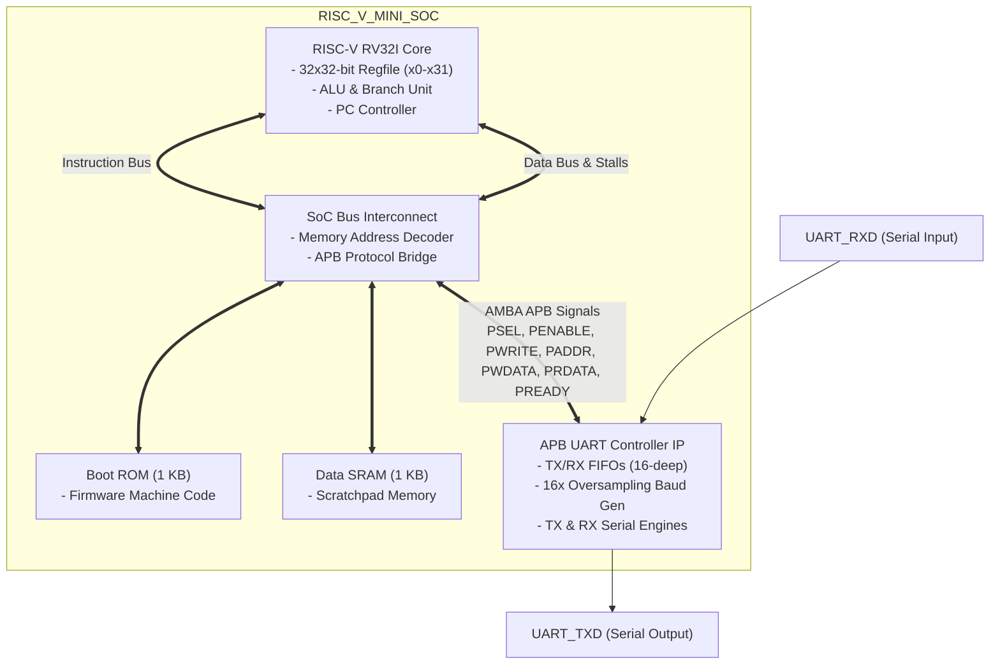

# RISC-V RV32I Mini-SoC with AMBA APB UART IP Core

[](https://github.com/lytuannghi)
[](https://riscv.org/)
[](https://developer.arm.com/)
[](https://github.com/lytuannghi)

A complete synthesizable **RISC-V RV32I Embedded System-on-Chip (SoC)** featuring:
- **Processor:** 32-bit RISC-V RV32I Core with 32 general-purpose registers (`x0-x31`) and ALU.
- **Memory Architecture:** 1 KB Instruction Boot ROM and 1 KB Data SRAM.
- **Bus System:** Memory-Mapped Interconnect and AMBA APB Master Bridge.
- **Peripheral:** Industrial APB UART Controller with independent 16-deep FIFOs.
- **Firmware:** Bare-metal assembly program computing Fibonacci numbers and streaming `"HELLO RISC-V!"` across the serial interface.

Designed and verified by **Lý Tuấn Nghi ([@lytuannghi](https://github.com/lytuannghi))** and the **7-Agent Autonomous SoC Team**.

---

## SoC Hardware Architecture



---

## Verification & Co-Simulation Results

```text
========================================================
 STARTING RISC-V MINI-SOC AUTOMATED VERIFICATION
========================================================
  CPU Reset Released. Fetching instructions from ROM...
 UART CONSOLE OUTPUT: HELLO RISC-V!
--------------------------------------------------------
 VERIFYING ON-CHIP DATA MEMORY (RAM):
 [PASS] Fibonacci Sequence in RAM: F(7) = 13 Verified!
 [PASS] Firmware Completion Signature Verified (0x12345678)!
 [PASS] UART Serial Transmission Verified (Received 13 characters)!
========================================================
 STATUS: 100% RISC-V SOC VERIFICATION PASSED!
========================================================
```

---

## Quickstart

```powershell
# Run the complete hardware/software co-simulation
python run_soc_flow.py

# View simulation waveforms
gtkwave output/waveform.vcd
```
